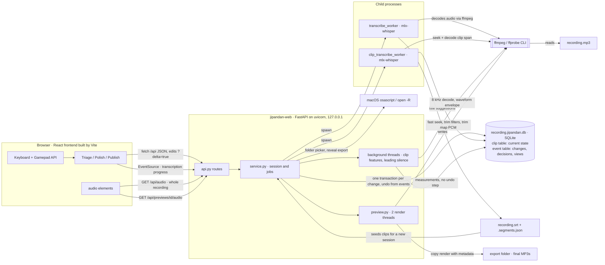

# Architecture

How the parts of the app and the outside tools fit together, as of the event store (#37) and the Publish stage (#39).

- **FFmpeg does all audio work.** The server runs the `ffmpeg` and `ffprobe` CLIs as subprocesses for clip features, waveforms, leading-silence detection, preview and export renders, and decoding for Whisper (mlx-whisper calls `ffmpeg` itself). Seeks jump straight to the clip when a once-per-file check shows it is sample-exact (`core/ffmpeg.py`).
- **SQLite holds all review state.** One `.jipandan.db` beside each recording has a clip table with the current state and an append-only event table with every change, decision, and view; undo comes from the events (`core/store.py`). Each undoable change records the fields it set, so Undo restores only those; background runs such as leading-silence detection are logged but never undoable. The SRT is only read to create clips when a session starts: either the transcript lines or the generated clips in `<recording>.candidates.srt`, as chosen under **Clips from** on the Transcription screen, and a session keeps following the SRT it started from. A session's review set (#82) lives in the database's meta table and never changes once picked; while it is open, the server tags each clip with its role (`top` or `random`) and the browser shows only those clips.
- **Snap points come with the transcript.** While Whisper transcribes with word timestamps, Silero VAD (v6.2.3 through ONNX Runtime, `core/vad.py`) runs in a thread on the CPU. The transcript gets a `.snap.json` sidecar with word starts and speech ends, tied to the SRT's SHA-256 like `.segments.json`; a VAD failure only leaves speech ends out. A new session copies them into the `snap_point` table. In Polish, a dragged start edge snaps to word starts and an end edge to speech ends within 8 screen pixels (Option bypasses it), and Option with the nudge keys jumps an edge to the previous or next point within 5 s (#58).
- **Whisper runs in child processes,** so long jobs can be cancelled without blocking the server. Full transcription writes the SRT; per-clip re-transcription writes title suggestions to the database.
- **The browser plays audio itself,** streaming the whole recording or a rendered preview MP3 over HTTP. mpv belonged to the retired TUI and is no longer used.
- **One set of UI pieces.** `frontend/src/ui.tsx` holds the panel, section header, buttons, badges, and the list-plus-main `StageLayout` that Triage, Polish, and Publish share, with their styles in `style.css`. Status labels come from its `statusLabels` (`group1` shows as Needs work, `group2` as Ready). Build new screens from these rather than one-off Tailwind classes.
- **Triage keeps context without changing its one-clip interaction.** Its left rail combines segmented decision progress with a bounded Up next queue containing the current clip and five Likely keep candidates. The main waveform is view-only and includes padded surrounding audio.

## Input

- Keyboard shortcuts are matched by `KeyboardEvent.code`, so they follow key position rather than the typed character. To test them from a script or a browser automation tool that sends no `code`, dispatch `KeyboardEvent`s with `code` set from JavaScript.
- Focus policy: keyboard shortcuts work wherever focus is, except in text fields and during IME composition. A focused button keeps only Enter, and Space always drives playback.
- The shortcuts help dialog is grouped by stage from `frontend/src/cheatsheet.ts`, which uses the labels each screen shows; `cheatsheet.test.ts` checks that every listed key resolves to its action. Keep frontend file names distinct beyond letter case: `tsc` rejects two files that differ only in case (TS1149), even on macOS.
- Gamepad actions are polled through the Gamepad API and don't depend on DOM focus.
- Each control can be bound once per context (review, dialogs, Publish), and only the current context's binding fires.
