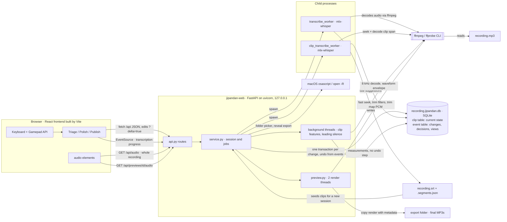

# Architecture

How the parts of the app and the outside tools fit together, as of the event store (#37) and the Publish stage (#39).

- **FFmpeg does all audio work.** The server runs the `ffmpeg` and `ffprobe` CLIs as subprocesses for clip features, waveforms, leading-silence detection, preview and export renders, and decoding for Whisper (mlx-whisper calls `ffmpeg` itself). Seeks jump straight to the clip when a once-per-file check shows it is sample-exact (`core/ffmpeg.py`).
- **SQLite holds all review state.** One `.jipandan.db` beside each recording has a clip table with the current state and an append-only event table with every change, decision, and view; undo comes from the events (`core/store.py`). The SRT is only read to create clips when a session starts.
- **Whisper runs in child processes,** so long jobs can be cancelled without blocking the server. Full transcription writes the SRT; per-clip re-transcription writes title suggestions to the database.
- **The browser plays audio itself,** streaming the whole recording or a rendered preview MP3 over HTTP. mpv belonged to the retired TUI and is no longer used.
