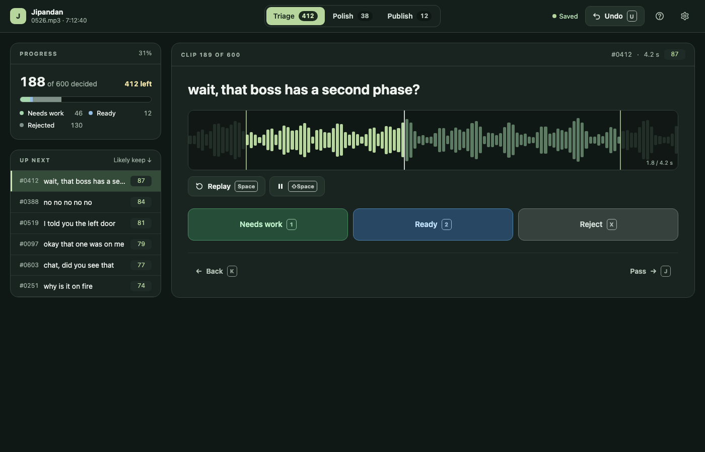
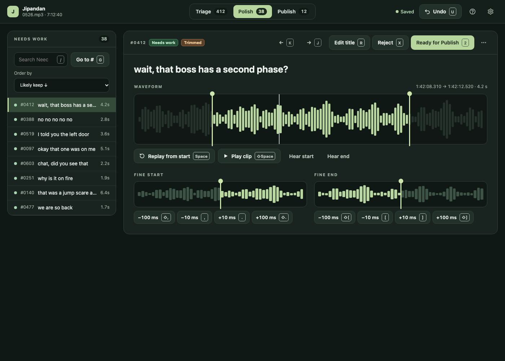
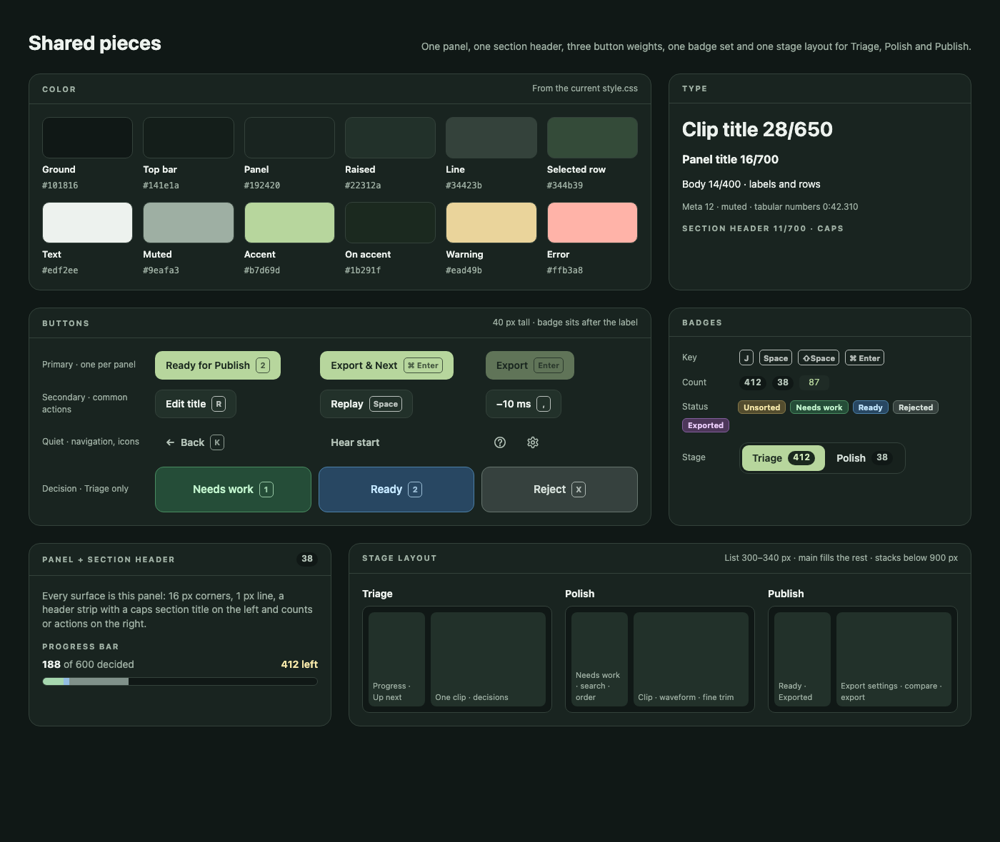
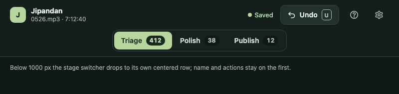

# Step 2 UI mockup

The shared style the owner approved in [#41](https://github.com/pomodorozhong/jipandan-clip/issues/41), for the UI consistency issues #42–#44. Each screen is also a static HTML page you can open in a browser. Clip titles and counts are sample data.

The decisions behind it are listed in the [rebuild plan](../../app-rebuild-plan.md#step-2-previews-and-publish) and in the closing comment on #41.

## Triage

Top bar, progress panel, Up next list, and a view-only waveform with padding around the clip. [HTML](triage.html)

## Polish

The Needs work list beside the clip header, waveform, and fine trim. [HTML](polish.html)

## Shared pieces

Colors, type, buttons, badges, panel, and the stage layout. [HTML](shared-pieces.html)

## Top bar at 800 px

Below 1000 px the stage switcher moves to its own centered row. [HTML](top-bar-800.html)

